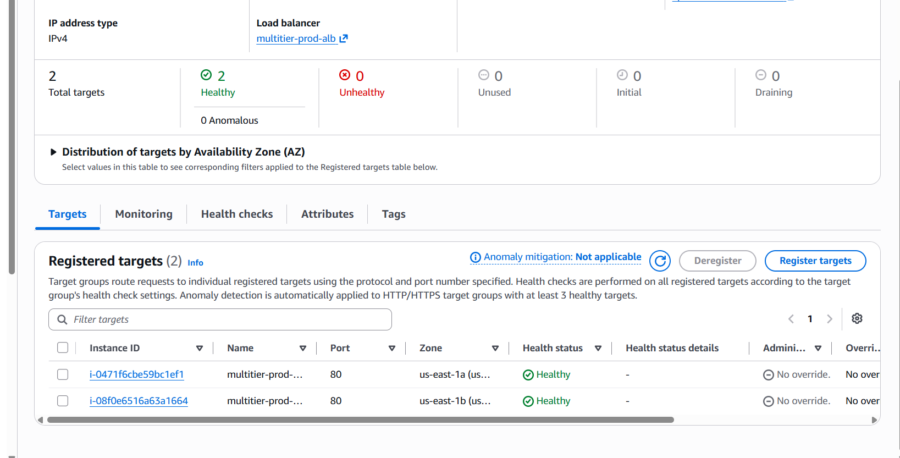

# Multi-tier app on AWS with Terraform and Ansible

I built this to practise doing infrastructure properly instead of clicking through the console. It deploys a small
Node.js + PostgreSQL app in two shapes:

- **dev**: one EC2 instance running nginx, the Node API and a local Postgres. About $0.02/hour.
- **prod**: an Application Load Balancer, an Auto Scaling group across two AZs and a private RDS PostgreSQL
  instance, with CloudWatch alarms and a dashboard. About $0.11/hour, so I apply it, check it, and destroy it.

Terraform builds the infrastructure, Ansible configures the servers, and GitHub Actions runs lint and security
checks on every push.

## What it looks like



The prod stack after a fresh apply: both targets healthy, one per AZ.

More screenshots are in [docs/screenshots](docs/screenshots): the CloudWatch dashboard, the RDS settings, the
security groups, the Auto Scaling group and the Terraform state.

## Architecture (prod)

```
                    Internet
                       |  :80
                 +-----v------+
                 |    ALB     |   public subnets, 2 AZs
                 +-----+------+
          +------------+-------------+
          |                          |
   +------v------+            +------v------+
   |  EC2  (AZ a)|            |  EC2  (AZ b)|     Auto Scaling group, min 2 / max 3
   |  nginx:80   |            |  nginx:80   |     CPU target tracking, rolling refresh
   |  node:3000  |            |  node:3000  |
   +------+------+            +------+------+
          |  5432, app SG only       |
          +------------+-------------+
                       |
              +--------v---------+
              |  RDS PostgreSQL  |   private subnets, encrypted, not public
              |  password in     |
              |  Secrets Manager |
              +------------------+
```

How the pieces fit:

- The app instances boot from a launch template. `user_data` pulls the repo from S3, fetches the database
  password from Secrets Manager using the instance role, and runs the same Ansible roles I use for dev
  (`local.yml`, connection `local`). So there is one set of roles for both environments.
- The ALB health-checks `/health`. The app also has `/api/status`, which actually queries the database, so a
  database problem shows up there without making the load balancer kill healthy instances.
- No SSH. I get a shell with SSM Session Manager.
- There is no NAT gateway. It would cost about $32 a month, which is too much for my budget, so the instances sit
  in public subnets and their security group only accepts traffic from the ALB. The trade-off is written up in
  [docs/architecture.md](docs/architecture.md).

## Repo layout

```
app/                   Node API, tests, Dockerfile
terraform/bootstrap/   S3 state bucket and the GitHub OIDC role (applied once, by hand)
terraform/modules/     network, compute, database, web (ALB + ASG), observability
terraform/envs/dev/    single instance
terraform/envs/prod/   ALB + ASG + RDS + alarms
roles/, site.yml       Ansible roles; site.yml targets the dev instance over SSH
local.yml              same roles, run on the instance itself at boot (prod)
docs/                  architecture notes, cost notes, screenshots
```

## Running it

You need the AWS CLI configured, Terraform 1.10 or newer, Node 20+, and Ansible on Linux, macOS or WSL (only
needed for dev).

```bash
# app tests
cd app && npm ci && npm test && cd ..

# one-time: state bucket and the CI role
terraform -chdir=terraform/bootstrap init
terraform -chdir=terraform/bootstrap apply -var github_repo=<owner>/<repo>

# prod
cd terraform/envs/prod
cp backend.hcl.example backend.hcl      # put the bucket name in it
terraform init -backend-config=backend.hcl
terraform apply
curl "$(terraform output -raw app_url)/api/status"

# when you are done looking at it
terraform destroy
```

The dev environment works the same way from `terraform/envs/dev`, then run
`ansible-playbook site.yml` once SSH is enabled for your IP (`enable_ssh` and `operator_cidr` in
`terraform.tfvars`). RDS is the slow part of a prod apply.

## CI

- `ci.yml` runs on every push and PR: app tests and `npm audit`, `terraform fmt` and `validate`, tflint,
  ansible-lint, Trivy (config and filesystem), Checkov, Gitleaks, and a Docker build with a Trivy image scan.
- `terraform-plan.yml` runs `terraform plan` on PRs that touch `terraform/`, authenticating to AWS through
  GitHub OIDC with a read-only role, and posts the plan as a comment. Infracost is optional.
- CI never applies anything. I apply by hand, which keeps the blast radius and the bill small.

For the plan job, set two repository variables from the bootstrap output: `AWS_ROLE_ARN` and `TF_STATE_BUCKET`.

## Things I ran into

These are the bugs that actually cost me time, in case they help someone:

- **`umask` in user_data.** I set `umask 077` while writing the DB secret to a file, and forgot to put it back.
  `npm ci` then created `node_modules` readable only by root, so the service user could not load any module and
  the app crashed. nginx answered 502, the targets went unhealthy and the instance refresh got stuck. The fix is
  `umask 022` after the secret is used, plus an Ansible task that sets permissions explicitly.
- **Free-tier RDS** rejects a backup retention above 1 day. It is a variable now, defaulting to 1 for prod.
- **A dropped connection during `apply`** left RDS created but missing from state. I recovered it by
  force-unlocking the stale lock, pushing the saved `errored.tfstate`, and untainting the instance.
- **Ubuntu 22.04's `nodejs` package is v12**, so the backend role installs the official tarball and checks its
  SHA-256.

## Known gaps

- HTTP only for now. The Terraform for HTTPS (ACM, Route 53, redirect) is there, behind `domain_name` and
  `hosted_zone_id`, but I have not applied it because I do not own a domain for this.
- The CI workflows are written but I have not seen a green run yet.
- No automated deploy. A change to the app means `terraform apply`, which rolls the instances.

More detail: [docs/architecture.md](docs/architecture.md) and [docs/cost.md](docs/cost.md).
